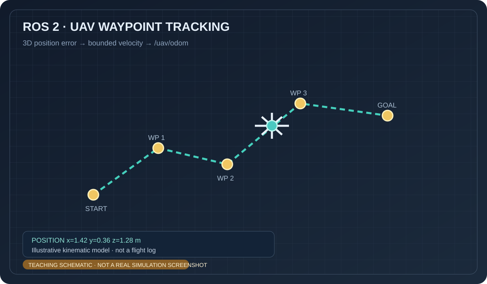

# 无人机三维航点跟踪

该练习按顺序跟踪三维航点，输出受限速参数约束的速度指令，并发布运动学模型的 Odometry。完整代码位于 `src/chap9/uav_waypoint_pid/`。

> 上图为 AI 生成的概念示意图，不是飞控或仿真器截图。

运行：`source /opt/ros/humble/setup.bash && python3 src/chap9/uav_waypoint_pid/main.py`。节点用于讲解航点误差控制，不连接飞控，不能直接用于真实无人机。
